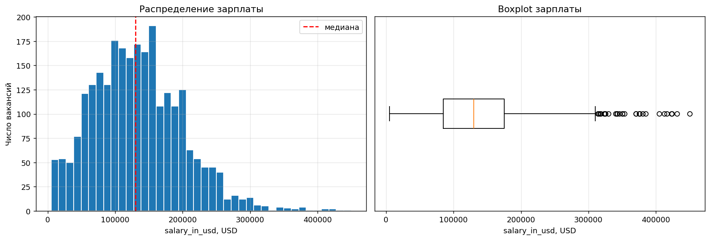
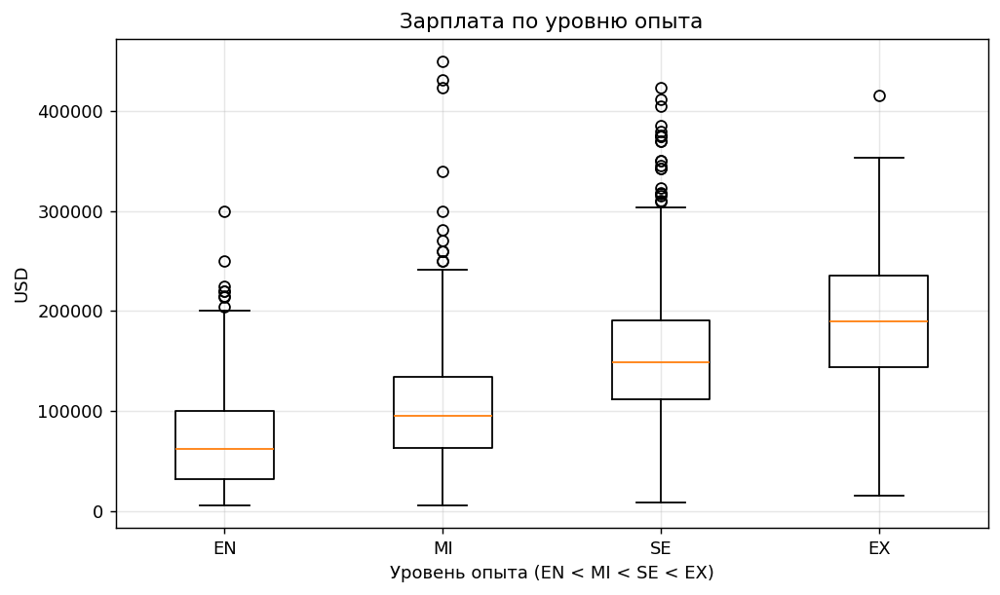
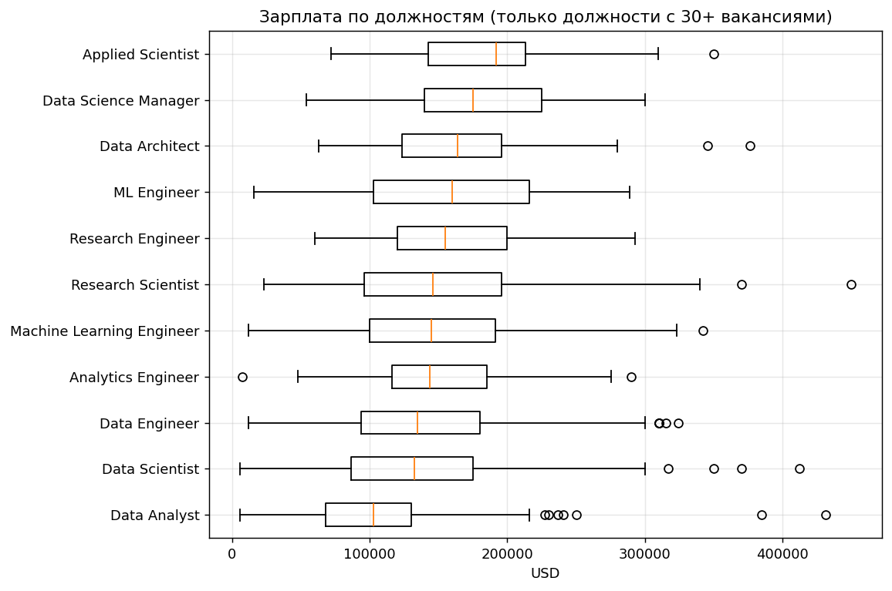
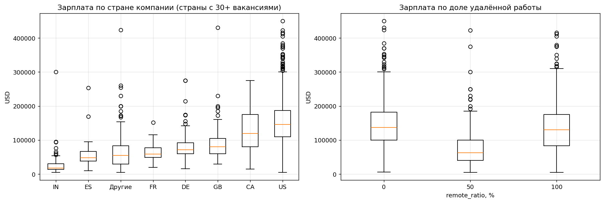
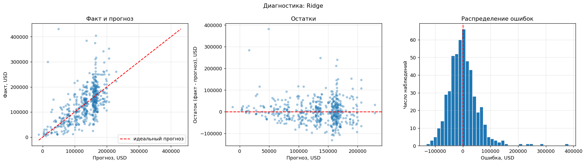

# Зарплаты в data science, ML и AI: анализ и линейная регрессия на pandas и NumPy

Учебный проект: полный цикл работы с табличными данными (очистка, EDA, проверка гипотез, три регрессионные модели, диагностика) на открытом датасете Kaggle. Используются только `pandas`, `numpy` и `matplotlib`: линейная регрессия, Ridge, кросс-валидация, метрики и статистические тесты написаны вручную, чтобы был понятен каждый шаг.

> **Важное уточнение к теме.** Датасет описывает не весь IT-рынок, а роли в data / ML / AI (Data Scientist, Data Engineer, ML Engineer, Data Analyst и т. д.). Все выводы относятся только к ним.

## Постановка задачи

Спрогнозировать зарплату специалиста в USD (`salary_in_usd`) по характеристикам вакансии: уровень опыта, должность, страна и размер компании, тип занятости, доля удалённой работы, год. Заодно выяснить, какие факторы связаны с зарплатой. Основная модель - линейная регрессия; Dummy служит ориентиром, Ridge проверяет, помогает ли регуляризация.

## Источник данных

[Data Science Salaries 2023](https://www.kaggle.com/datasets/arnabchaki/data-science-salaries-2023) (Kaggle, автор arnabchaki), первичный источник - ai-jobs.net. Лицензия: [Open Data Commons DbCL 1.0](https://opendatacommons.org/licenses/dbcl/1-0/). Копия исходного файла лежит в репозитории: [`data/ds_salaries.csv`](data/ds_salaries.csv) (без изменений; вся очистка выполняется в коде). Условия использования и атрибуция - в [`data/README.md`](data/README.md).

## Описание признаков

| Столбец | Описание | Роль в модели |
|---|---|---|
| `salary_in_usd` | зарплата, USD | целевая переменная |
| `work_year` | год | числовой признак |
| `experience_level` | EN / MI / SE / EX | категориальный |
| `employment_type` | FT / PT / CT / FL | категориальный |
| `job_title` | должность (93 значения) | категориальный |
| `company_location` | страна компании | категориальный |
| `company_size` | S / M / L | категориальный |
| `remote_ratio` | доля удалённой работы: 0 / 50 / 100 | категориальный |
| `salary`, `salary_currency` | зарплата в исходной валюте | исключены (утечка: `salary_in_usd` посчитана из них) |
| `employee_residence` | страна сотрудника | исключён (в 97% строк совпадает со страной компании) |

## Технологии и что написано вручную

Python 3.11+, Jupyter Notebook, `pandas`, `numpy`, `matplotlib`.

| Что | Как реализовано |
|---|---|
| Разбиение на train/test | случайная перестановка номеров строк (`np.random.default_rng`) |
| One-hot кодирование | `pd.get_dummies`, базовая категория пропускается |
| Линейная регрессия | решение методом наименьших квадратов через `np.linalg.lstsq` |
| Ridge | формула `(X'X + alpha·I)^-1 X'y`, свободный член не штрафуется |
| Подбор alpha | кросс-валидация на 5 частях, только на обучающей выборке |
| Метрики MAE, RMSE, R² | формулы на numpy |
| Проверка гипотез | перестановочные тесты (10 000 перемешиваний) |

## Очистка и исследование

- Исходно 3755 строк и 11 столбцов, пропусков нет, `salary` и `salary_in_usd` согласованы (для строк в USD они совпадают, курсы конвертации внутри пары «валюта - год» постоянны).
- **Дубликаты:** 1171 полный дубликат (31,2%), сосредоточены в 2022-2023 годах, в компаниях размера M и в США. Без идентификатора вакансии нельзя отличить повторную запись от разных людей с одинаковыми характеристиками, поэтому удаление - допущение. Проверка на 10 разбиениях показала, что оставленные дубликаты делают оценку качества несколько оптимистичнее (R² 0,406 против 0,380). После очистки: **2584 строки**.
- **Выбросы:** высокие зарплаты не удалялись. По IQR выше границы 310 038 USD лежит 29 наблюдений (1,1%). Отмечены единичные подозрительные строки (например, аналитик в Великобритании с 430 967 USD при медиане по группе около 61 тыс.).
- Редкие категории (меньше 30 наблюдений) объединяются в `Other`, и частоты считаются только по обучающей выборке.

## Основные графики и наблюдения

| | |
|---|---|
|  |  |
|  |  |

- Распределение зарплаты умеренно скошено вправо (асимметрия 0,62), медиана 130 000 USD.
- Медиана растёт с опытом: EN 61 900, MI 95 000, SE 148 800, EX 189 619 USD.
- Сильнее всего различаются страны: США 145 885 USD (74,7% выборки), Индия 18 314 USD.
- Размер компании и удалённость в «сырых» медианах вводят в заблуждение из-за разного состава по странам (в компаниях размера L 54% вакансий в США против 82% у M).
- Доля дисперсии зарплаты, объяснённая отдельными признаками (η²): страна 0,30, опыт 0,23, должность 0,16, размер компании 0,06, удалёнка 0,06, тип занятости 0,02.

## Проверенные гипотезы (α = 0,05, перестановочные тесты)

| Гипотеза | Статистика | p-value | Эффект | Вывод |
|---|---|---|---|---|
| Зарплата различается между уровнями опыта | η² | < 0,0001 | η² = 0,23 | H0 отвергается, эффект крупный |
| Медианы при 100% удалёнке и в офисе (0%) различаются | разница медиан | ≈ 0,016 | вероятность превосходства 0,45 (медианы 130 000 и 137 500 USD) | значимо, но эффект малый |
| Медианы в США и в других странах различаются | разница медиан | < 0,0001 | вероятность превосходства 0,85 (медианы 145 885 и 65 666 USD) | H0 отвергается, эффект очень большой |

Тип занятости не проверялся: в группах PT, CT, FL всего 17, 10 и 10 вакансий.

## Модели

Все модели обучаются на одной и той же обучающей выборке (80%, `seed=42`).

- **Dummy (медиана)** - ориентир.
- **LinearRegression** - основная модель, коэффициенты интерпретируются относительно базовой категории (EN, FT, Data Scientist, US, размер M, удалёнка 0%).
- **Ridge** - L2-регуляризация; `alpha` подбирается кросс-валидацией на обучающей выборке (выбрано 0,5).

## Результаты (тестовая выборка, 517 строк)

| Модель | MAE, USD | RMSE, USD | R² |
|---|---|---|---|
| Dummy (медиана) | 53 295 | 68 310 | -0,003 |
| LinearRegression | 38 397 | 53 714 | 0,380 |
| Ridge (alpha = 0,5) | 38 385 | 53 705 | 0,380 |

Повтор на 10 разных разбиениях: LinearRegression MAE 39 318 ± 1 282 и R² 0,380 ± 0,039; Ridge практически идентичен. Таблица метрик одного запуска сохраняется в `reports/metrics.csv`.



## Основные выводы

1. Страна компании, уровень опыта и должность - главные факторы, связанные с зарплатой в этих данных.
2. LinearRegression снижает MAE на 28% по сравнению с прогнозом медианой, но типичная ошибка остаётся около 38 тыс. USD (около 29% медианной зарплаты). Модель различает «грубые» профили, а не предсказывает точную зарплату.
3. Ridge не улучшил качество: сильной мультиколлинеарности и переобучения нет (R² на обучающей выборке 0,43, на тесте 0,38).
4. Модель завышает прогноз для низких зарплат и занижает для высоких (в верхнем квартиле в среднем на 60 тыс. USD); ошибка максимальна на уровне EX (MAE 54 тыс.). Часть прогнозов отрицательна (0,2%).
5. Один подозрительный пример (аналитик в Великобритании, 430 967 USD) заметно ухудшает RMSE и R² на тесте; без него R² был бы 0,419 вместо 0,380.

## Ограничения исследования

- Только роли data / ML / AI; 75% вакансий в США, 88% наблюдений относятся к 2022-2023 годам.
- Удаление дубликатов - допущение без идентификатора вакансии.
- Нет навыков, названия компании, города, образования, бонусов. Зарплаты номинальные, без поправки на стоимость жизни.
- Корреляции и коэффициенты не доказывают причинность; признаки связаны между собой.
- Линейная аддитивная модель не учитывает взаимодействия (например, «опыт × страна»).
- Перестановочные тесты предполагают независимость наблюдений, которую здесь нельзя гарантировать.

## Установка и запуск

```bash
python -m venv .venv
source .venv/bin/activate        # Windows: .venv\Scripts\activate
pip install -r requirements.txt

# Данные уже лежат в data/ds_salaries.csv, ничего скачивать не нужно

# 2. Исследование и все графики
jupyter notebook notebooks/salary_analysis.ipynb

# 3. Только обучение и сравнение моделей из командной строки
python -m src.train
```

Запускайте команды из корня репозитория.

## Структура репозитория

```text
ds-salary-analysis/
├── data/
│   ├── ds_salaries.csv        # исходные данные (Kaggle), без изменений
│   └── README.md              # источник, лицензия и атрибуция
├── notebooks/
│   └── salary_analysis.ipynb  # исследование, графики, гипотезы, выводы
├── src/
│   ├── data_processing.py     # очистка, разбиение, кодирование категорий
│   ├── train.py               # три модели на numpy, кросс-валидация
│   └── evaluate.py            # метрики и диагностические графики
├── reports/
│   ├── figures/               # графики из ноутбука
│   └── metrics.csv            # таблица метрик на тесте
├── requirements.txt
├── .gitignore
└── README.md
```
